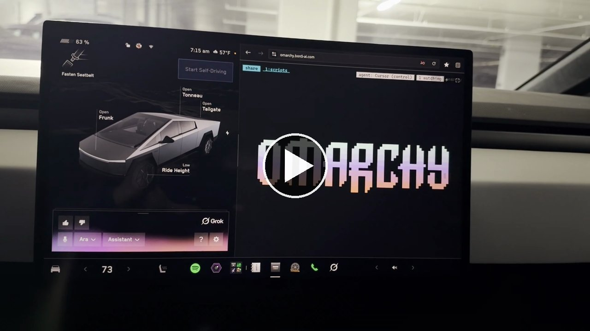

# BON5AI Remote Viewer

Share a tmux session as a live, **read-only** view in any browser: scan a QR code with a
phone and watch your terminal. Let AI agents (Claude Code, or any MCP client) read that same
session and, if you allow it, type into it.

[](https://x.com/mikeg0/status/2115439092012089698)

Nobody gets in without the person at the terminal:

- **Browsers** pair with a one-time code you mint in your shell. The QR code carries it.
- **Agents** sign in with OAuth, and **you approve each one at the terminal.** You choose
  what it may do (observe, suggest, or control) and which pane it gets. The status line
  shows it for as long as it has access, and one key revokes it.

```
                             ┌───────────────────── your machine ──────────────────────┐
 phone / browser ──HTTPS──┐  │                                                         │
                          ├──┼─► proxy or tunnel ──► gate (127.0.0.1:8095) ──┐         │
 agent (MCP + OAuth) ─────┘  │                       │  ▲                    ▼         │
                             │          admin socket │  │            asciinema stream  │
                             │                (0600) │  │               (read-only     │
                             │           you: share, │  │              tmux client)    │
                             │        code, approve ─┘  │ capture-pane /     │         │
                             │                          │ send-keys          ▼         │
                             │                          └────────────── tmux server    │
                             │                                       (its own socket)  │
                             │                                        session "share"  │
                             └─────────────────────────────────────────────────────────┘
```

## Requirements

- Linux. CI runs the test suite, real-tmux tests included, on Linux only. The code's macOS
  paths, the launchd service among them, are still there but nothing tests them.
- Python 3.11 or later
- tmux 3.2 or later
- [asciinema](https://asciinema.org) 3.0 or later, for `asciinema stream`. Many distributions
  still ship 2.x, so get 3.x from its [releases page](https://github.com/asciinema/asciinema/releases).

## Install

```bash
uv tool install bon5ai-remote-viewer      # or: pipx install bon5ai-remote-viewer
tmux-remote-viewer doctor
```

From a checkout: `uv tool install --editable .`

## Quick start

```bash
tmux-remote-viewer install-service --enable     # run the gate as a user service (systemd or launchd)
tmux-remote-viewer share                        # start the shared session: prints a QR code and a code
```

Open `http://127.0.0.1:8095/` and enter the code, or scan the QR code once the gate has a
public URL (see [Hosting](#hosting)).

| In the session | |
|---|---|
| detach | `Ctrl-b d`. Viewers keep watching. |
| rejoin | `tmux-remote-viewer share` |
| another viewer code | `tmux-remote-viewer code`. It lasts 10 minutes; `--ttl 30m` sets anything up to 1 hour. |
| end | exit the last shell. Viewers see "Session ended" and agents lose access. |
| revoke every agent | `prefix + X` |

## Add an agent

Agents sign in with OAuth, and you approve each sign-in at the terminal. Claude Code on
this machine reaches the gate on loopback. Claude, ChatGPT and Grok Bot call from their
provider's cloud, so they also need a public `public_url` (see [Hosting](#hosting)) and
their callback in `allowed_redirect_uris`, set before the first sign-in because
restarting the gate signs every agent out:

```toml
# ~/.config/bon5ai-remote/config.toml
allowed_redirect_uris = [
  "https://claude.ai/api/mcp/auth_callback",                # Claude
  "https://chatgpt.com/connector_platform_oauth_redirect",  # ChatGPT
  "https://www.cursor.com/agents/mcp/oauth/callback",        # Grok Bot
]
```

```bash
systemctl --user restart tmux-remote-viewer
```

A hosted callback serves every user of that service, so anyone can start a sign-in to
your gate: **approve only a request ID that is on a page you opened yourself.** For a
hosted callback, `agent approve` always needs the ID.

### Claude Code

```bash
claude mcp add --transport http tmux-remote-viewer http://127.0.0.1:8095/mcp
```

1. Run `/mcp`, choose **tmux-remote-viewer**, then **Authenticate**. A page opens with a
   request ID such as `K7QM`.
2. In your shell, run `tmux-remote-viewer agent approve K7QM`, then pick a scope and a
   pane. Claude Code finishes signing in, and the tmux status line shows the agent.

Details are in [docs/agents.md](docs/agents.md), including a token file for `claude -p`
and CI, and clients that can't open a browser.

### Claude

Claude on the web, in the desktop and mobile apps, and in Cowork share one connector.
Every plan can add one. On Team and Enterprise, an Owner adds it under **Organization
settings → Connectors**, and each member then clicks **Connect**.

1. Go to **Customize → Connectors**, then **Add custom connector**.
2. Name it and enter `https://term.example.com/mcp` as the MCP server URL. If the dialog
   asks, keep **Sign in now** and **Use Claude's published identity**: the gate reads
   Claude's client metadata document, so the approval shows `verified: claude.ai`.
3. Click **Add** and sign in. The gate's page opens with a request ID; approve it in your
   shell as above, and Claude lists the tools.
4. In a chat, click **+**, then **Connectors**, and turn it on. Claude asks before a tool
   runs; **Always allow** skips that for one tool.

### ChatGPT

ChatGPT needs a paid plan; in a workspace an owner may have to allow custom servers first.

1. Open [chatgpt.com/plugins](https://chatgpt.com/plugins), click **+**, then
   **Add custom MCP server**. Older builds have it under Settings → Connectors →
   Advanced → **Developer mode**, then **Create**.
2. Name it, enter `https://term.example.com/mcp` as the server URL, choose OAuth as the
   authentication, and accept the warning about unverified servers.
3. ChatGPT opens the gate's sign-in page with a request ID. Approve it in your shell as
   above, and ChatGPT lists the tools.
4. In a chat, type `@` and pick the server. `terminal_info`, `read_screen` and `wait_for`
   are annotated read-only, so ChatGPT runs them without asking and confirms the others
   with you.

### Grok Bot

Grok Bot has no settings form for custom servers. Ask it in chat, with the words "custom
MCP server" (otherwise it installs a catalog plugin instead):

> Add a custom MCP server named tmux-remote-viewer with the URL https://term.example.com/mcp

1. The bot repeats the name and URL and asks you to confirm, then posts a connect card.
   Click **Authorize**.
2. The gate's sign-in page opens with a request ID. Approve it in your shell as above.
3. The card completes the sign-in and the bot lists the tools. The server appears under
   Settings → Plugins → **Yours**; type `@` in a chat to attach it.

Grok Bot also registers a `cursor://` callback. The gate drops it and keeps the https one,
so the entry above is all it needs.

## Hosting

The gate only ever listens on loopback, or on a private address you explicitly allow. To
reach it from elsewhere, put something in front of it:

| Setup | Reach | Guide |
|---|---|---|
| Local only | this machine | [docs/deploy/local.md](docs/deploy/local.md) |
| Tailscale Serve | your tailnet | [docs/deploy/tailscale.md](docs/deploy/tailscale.md) |
| Tailscale Funnel | the internet | [docs/deploy/tailscale.md](docs/deploy/tailscale.md#funnel-public) |
| AWS CloudFront + Funnel | the internet, on your domain, with an origin secret | [docs/deploy/aws-cloudfront.md](docs/deploy/aws-cloudfront.md) (CloudFormation template included) |
| Caddy, nginx, Cloudflare Tunnel, Traefik | your choice | [docs/deploy/reverse-proxy.md](docs/deploy/reverse-proxy.md) |

## Agents in brief

| Scope | Tools |
|---|---|
| `observe` | `terminal_info`, `read_screen`, `wait_for` |
| `suggest` | + `send_text` at a shell prompt, without pressing Enter or Tab. You decide whether it runs. |
| `control` | + `send_keys`, `run_command` |

Every grant is pinned to one pane. It ends when you revoke it, when it expires (12 hours
by default), when the session ends, or when the gate restarts.

Writes are refused when:

- the pane is in copy mode or not on screen;
- you typed in the last two seconds;
- the screen changed since the agent last read it.

Text can't carry escape sequences or invisible characters. The audit log records every
approval and every keystroke an agent sent.

## Security

Read [docs/threat-model.md](docs/threat-model.md) before you give an agent `control`,
which is your shell. The short version:

- **Read-only is not harmless.** Everything printed in the session is visible to viewers
  and goes to an observing agent's model provider. Don't `cat` secrets while sharing.
- **Pairing on one machine is consent, not isolation.** An agent with a shell as your user
  can run tmux itself. Isolation comes from running the agent somewhere the tmux socket
  isn't reachable.
- **Report vulnerabilities privately:** see [SECURITY.md](SECURITY.md).

## Configuration

Everything is optional. With no file, you get one loopback listener on port 8095. See the
annotated [config.example.toml](config.example.toml), and copy it to
`~/.config/bon5ai-remote/config.toml`.

| Environment variable | |
|---|---|
| `BON5AI_REMOTE_CONFIG` | config file path |
| `BON5AI_REMOTE_PROXY_SECRET` | the proxy header's secret (or use `proxy_secret_file`) |
| `BON5AI_REMOTE_RUNTIME_DIR` | where the sockets live (default `$XDG_RUNTIME_DIR/bon5ai-remote`) |

`tmux-remote-viewer config` shows the effective settings without the secret, and
`tmux-remote-viewer doctor` checks the whole setup.

## How the viewer works

- **The stream.** `share` creates the tmux session on the gate's own tmux server and starts
  `asciinema stream --local` on a random loopback port. asciinema watches through a hidden
  tmux client attached with `read-only,ignore-size`.
- **Sizing.** A small wrapper keeps asciinema's terminal the size of the tmux window, so
  viewers never see tmux's dotted margins or a cropped screen.
- **Fitting the viewer.** With `viewer_resize = true`, a viewer's page sizes the session
  to its own screen while you are detached and it is the only viewer watching, so a phone
  gets a grid of its own shape instead of a letterboxed copy of yours. Its − and + buttons
  set the text size. When you attach, or a second viewer starts watching, the session goes
  back to your size.
- **The page.** The gate serves the page, proxies asciinema's own player (so player and
  stream always match), and relays the WebSocket. The cookie and Origin are checked
  first, and only the handshake headers go upstream.
- **Status.** The page polls `status` and shows the stream live, the host away (detached;
  still live), the stream down, or the session ended. It also names the host and tmux
  session, which the page puts in its title (`host: session`).
- **Fonts.** The terminal is drawn in Cascadia Mono, served by the gate (SIL OFL 1.1), so
  box drawing and braille look right on every device.

## Troubleshooting

| Symptom | Fix |
|---|---|
| `421 Misdirected request` | The proxy sends a Host the gate doesn't expect. Find the `refused Host '...'` line in the gate's log and add that value to `allowed_hosts`. |
| `404` on every page behind CloudFront | `proxy_header` or the secret doesn't match the distribution's origin header. |
| "Stream offline" | Run `tmux-remote-viewer share` again; it restarts the stream. Errors are in `~/.local/state/bon5ai-remote/stream.log`. |
| An agent can't find the authorization server | Check that `<public_url>.well-known/openid-configuration` is reachable. Under a path, also see the [discovery note](docs/deploy/aws-cloudfront.md#mounting-under-a-path-of-an-existing-distribution). |
| `... is too long for a Unix socket` | Set `BON5AI_REMOTE_RUNTIME_DIR` to a shorter directory. |
| Gate logs: `journalctl --user -u tmux-remote-viewer -f` | |

## Development

```bash
uv venv && uv pip install -e '.[test]'
.venv/bin/python -m unittest discover -s tests -t tests
```

The tests cover:

- viewer pairing, cookies, the Host and proxy guards, and the WebSocket relay (against a
  fake asciinema);
- the whole OAuth sign-in through real HTTP, and the MCP tools in both protocol eras;
- every write-safety rule, and the CIMD fetch's SSRF fences;
- real tmux behaviour, on a private socket. These tests are skipped when tmux is missing.

## License

[MIT](LICENSE) © 2026 Bon5AI LLC. Cascadia Mono is © Microsoft, under the SIL Open Font
License 1.1 ([OFL.txt](src/bon5ai_remote/static/fonts/OFL.txt)).
